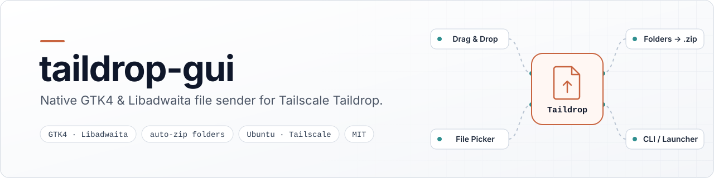

<div align="center">

<picture>
  <source media="(prefers-color-scheme: dark)" srcset="docs/assets/banner-dark.svg">
  
</picture>

**Drag-and-drop files and folders from Ubuntu to your Mac (or any Tailnet peer) over Tailscale Taildrop.**

[](https://github.com/ThaminduMiuranda/taildrop-gui/releases) [](https://github.com/ThaminduMiuranda/taildrop-gui/actions/workflows/release.yml) [](LICENSE) [](src/taildrop_gui/app.py) [](pyproject.toml)

[Features](#features) · [Install](#install) · [Quick Start](#quick-start) · [How It Works](#how-it-works) · [Security](#security) · [Building](#building)

</div>

## Why taildrop-gui

Sending files from Linux to macOS via Tailscale usually means opening a terminal, looking up device names, and manually zipping folders because `tailscale file cp` only accepts single files. `taildrop-gui` wraps `tailscale file cp` in a clean, native GNOME/Ubuntu desktop window so Taildrop feels as immediate as AirDrop.

## Features

- **Stage before sending:** Drag and drop one or many files onto the drop zone, review the staged list, remove mistakes, and send when ready.
- **Automatic folder archiving:** Dropped or picked folders are compressed to a temporary `.zip` before transfer and cleaned up automatically afterward.
- **Smart peer discovery:** Queries `tailscale status --json` (with `tailscale file cp --targets` fallback) and sorts online macOS peers to the top while supporting every peer on your Tailnet.
- **Live transfer queue:** Tracks queued, zipping, sending, completed, failed, and cancelled items with per-transfer cancellation.
- **Flexible inputs:** Works via drag-and-drop, native GTK file/folder pickers, CLI file arguments, or Ubuntu's `.desktop` launcher.
- **Zero PyPI runtime dependencies:** Uses system GTK4, Libadwaita, and Python's standard library.

## Install

### Prerequisites

- **Tailscale** installed, running, and signed in to your Tailnet (`tailscale` on `PATH`) with Taildrop enabled.
- **Ubuntu / Debian packages** (installed automatically when using the `.deb` installer):
  ```bash
  sudo apt install python3-gi gir1.2-gtk-4.0 gir1.2-adw-1
  ```

### Option 1: Ubuntu / Debian package (recommended)

Download the `.deb` file from the [latest GitHub Release](https://github.com/ThaminduMiuranda/taildrop-gui/releases/latest) and install it:

```bash
sudo apt install ./taildrop-gui_0.1.0_all.deb
```

This installs `/usr/bin/taildrop-gui` and registers **Taildrop to Mac** in your application launcher.

### Option 2: Standalone executable

Download `taildrop-gui` from the [latest GitHub Release](https://github.com/ThaminduMiuranda/taildrop-gui/releases/latest), make it executable, and run it:

```bash
chmod +x taildrop-gui
./taildrop-gui
```

### Option 3: Run from source with `uv`

```bash
git clone https://github.com/ThaminduMiuranda/taildrop-gui.git
cd taildrop-gui
uv run taildrop-gui
```

<details>
<summary><b>Install globally with uv or register the desktop launcher manually</b></summary>

```bash
# Install `taildrop-gui` onto your PATH
uv tool install .

# Register the desktop launcher entry
cp taildrop-gui.desktop ~/.local/share/applications/taildrop-gui.desktop
```

</details>

## Quick Start

1. Launch **Taildrop to Mac** from your Ubuntu application menu or run `taildrop-gui`.
2. Confirm your target peer in the **Destination** dropdown (online macOS devices are selected automatically).
3. Drag files or folders into the drop zone, or use **Select Files...** / **Select Folder...**.
4. Click **Send** to queue and transfer the staged items.

You can also pre-stage paths directly from the command line:

```bash
taildrop-gui /path/to/report.pdf /path/to/project-folder
```

## How It Works

1. **Peer discovery:** `discover_peers()` runs `tailscale status --json` and orders peers so online macOS devices appear first, falling back to `tailscale file cp --targets` if needed.
2. **Staging & archiving:** Dropped payloads (`Gdk.FileList`, `Gio.File`, or `file://` URI lists) are validated locally. Regular files are queued directly; folders are archived into an isolated temporary `.zip` using `zipfile` with `os.walk(..., followlinks=False)`.
3. **Transfer execution:** A background worker invokes `tailscale file cp <path> <target>:` without a shell (`subprocess.Popen` argument list) and supports immediate termination on cancellation.

## Security

`taildrop-gui` treats dropped URIs, local filesystem entries, and Tailscale peer metadata as untrusted inputs:

- **Strict peer identifier validation:** Enforces ASCII hostname/IPv4 allowlisting across `PeerDevice.target_id`, JSON parsing, `--targets` parsing, and CLI invocation so hostile peer names cannot inject flags or invalid arguments.
- **Path & special-file guards:** Uses `os.lstat` and strict path resolution to reject top-level symlinks, nested symlinks inside zipped folders, symlink loops, embedded null bytes, FIFOs, Unix sockets, device nodes, and remote RFC 8089 `file://` netlocs.
- **UI sanitization:** Strips C0/C1 control characters and Unicode bidi-override characters from displayed hostnames, filenames, and CLI errors, and disables Pango markup on banners and toasts.

## Building

Run the full unit and virtual-device adversarial security test suite:

```bash
uv run pytest -v
```

Run the GTK window self-test:

```bash
./taildrop_gui.py --self-test
```

Build the Python package, standalone `zipapp` executable, and `.deb` installer locally into `dist/`:

```bash
uv build
python3 scripts/build_artifacts.py
./dist/taildrop-gui --self-test
```

Pushing to `main` triggers [`.github/workflows/release.yml`](.github/workflows/release.yml) to run tests and upload build artifacts. Pushing a version tag (such as `v0.1.0`) publishes the standalone executable, `.deb` package, wheel, and source tarball to **GitHub Releases**.

## License

[MIT](LICENSE) © Thamindu Miuranda
